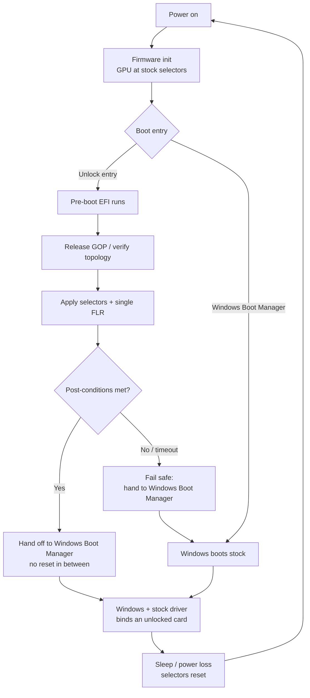

# Architecture

A map of how this project is organized and how a boot proceeds. The level of detail
here matches the public README; it is an orientation document, not a reverse-
engineering guide.

---

## 1. One-paragraph model

The tool runs a small **pre-boot EFI** step that, on the supported hardware, re-applies
NVIDIA's full-rate tensor selectors and then hands control to Windows Boot Manager —
**without** flashing the VBIOS or patching the driver. The change is volatile and is
re-applied on each cold boot. Everything else in the repository exists to make that
step **safe, verifiable, reproducible, and well-measured** on a given machine.

---

## 2. Boot flow

The two safety properties that matter most:

- **Fail-safe handoff.** If post-conditions are not met (or a timeout fires), the
  flow should hand off to a normal Windows boot rather than leave a half-applied
  state or a black screen. Hardening this path is roadmap item **#12**.
- **No permanence.** The `Sleep / power loss → selectors reset` edge is a physical
  fact, not a bug. "Always-on" is achieved only by re-running the pre-boot step every
  cold boot, never by a permanent latch.

---

## 3. Repository layout

| Path | Purpose |
| --- | --- |
| `unlock/`, `internal-boot/` | Boot/handoff sources, local build, install and host tests |
| `research/` | Compatibility probing, profile generation, PCI-decode research, per-card work |
| `benchmark/` | Locked-vs-unlocked measurement tooling (CUDA + runners) |
| `evidence/` | Sanitized, per-machine benchmark results tied to exact builds |
| `docs/` | Compatibility, assets, boot guides, recovery, and this architecture doc |
| `tools/` | Read-only user tooling (compatibility collector, USB prep, verifier) |
| `release/` | Release artifacts and provenance metadata |
| `scripts/` | Quality + safety tooling added by this foundation (verify, doctor) |
| `.github/workflows/` | CI quality gates and signed release automation |

---

## 4. Trust & verification surfaces

| Surface | How it is verified | Where |
| --- | --- | --- |
| Source integrity | SHA-256 of every tracked file vs. `SOURCE-MANIFEST.json` | `scripts/verify_manifest.py` (CI gate) |
| Environment readiness | Read-only prerequisite + recovery checks | `scripts/doctor.ps1` |
| Release authenticity | Sigstore/cosign signature + SLSA provenance attestation | `.github/workflows/release.yml` |
| No leaked secrets/firmware | Secret scan on every change | `.github/workflows/quality.yml` |

See [`SECURITY.md`](SECURITY.md) for the trust boundary and
[`docs/RECOVERY.md`](docs/RECOVERY.md) for the recovery ladder.

---

## 5. Design boundaries (unchanged by this foundation)

- No VBIOS flashing; no Windows driver replacement.
- Firmware, PROM/BIOS images, drivers and CUDA DLLs are **not** redistributed.
- Per-machine profiles are validated per machine; a host/build pass is not a hardware
  success.
- The CI added here deliberately covers **tooling, docs, integrity, and release
  hygiene** — it does not compile or publish the unlock payload.
